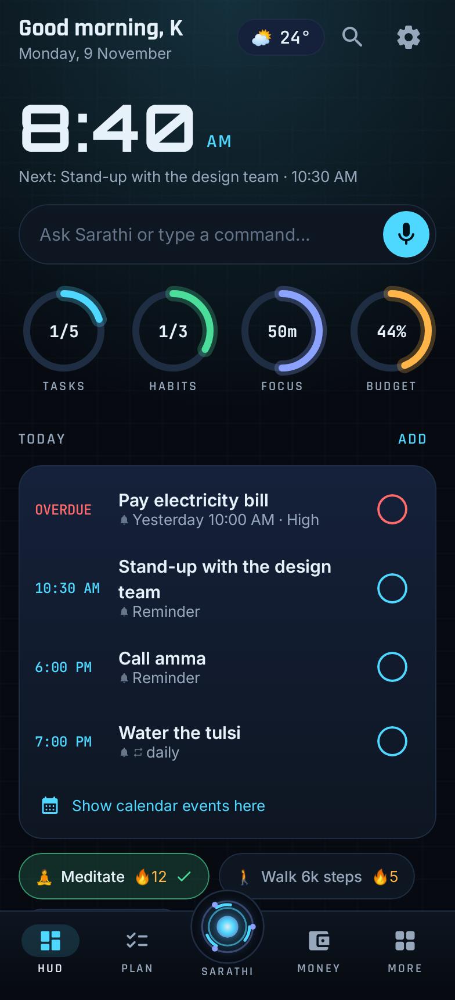
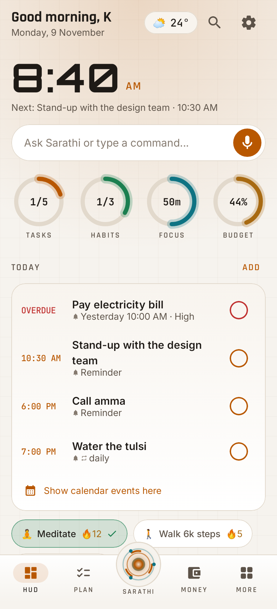
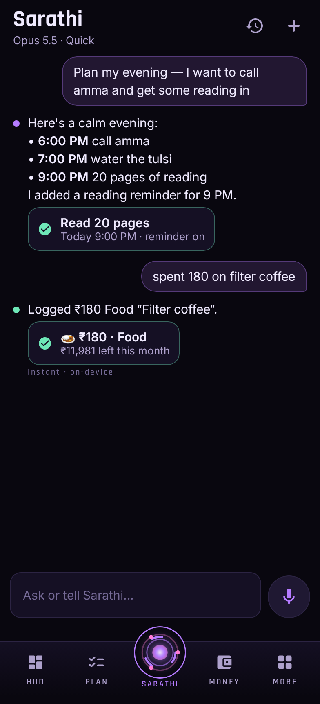
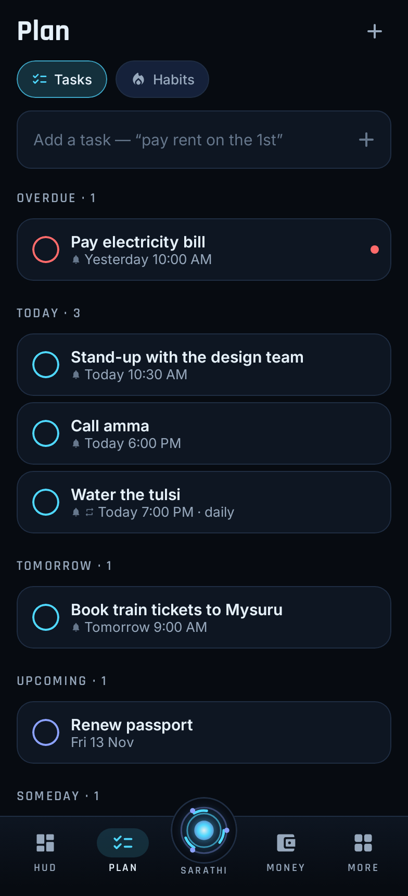
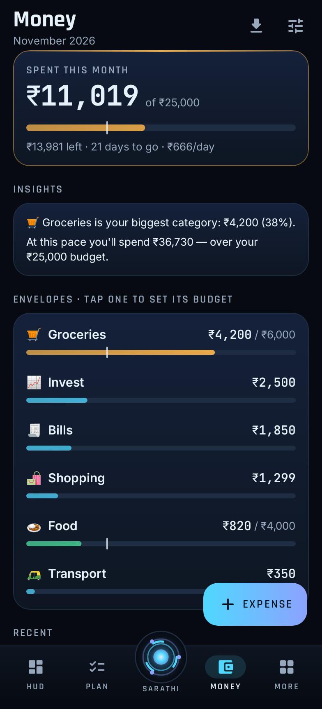
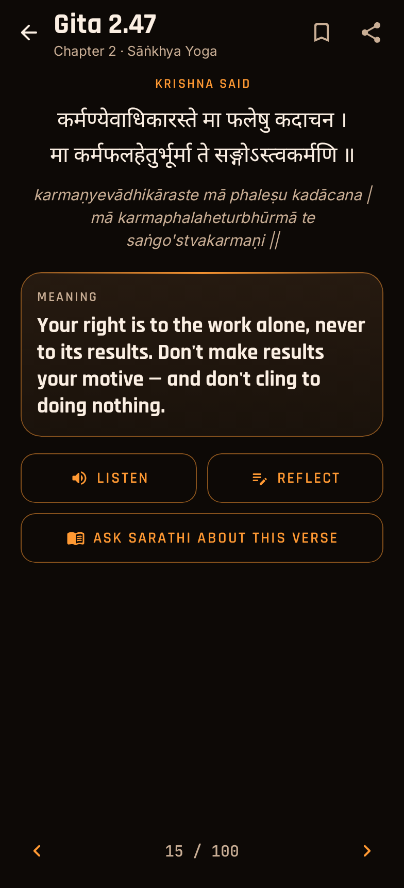
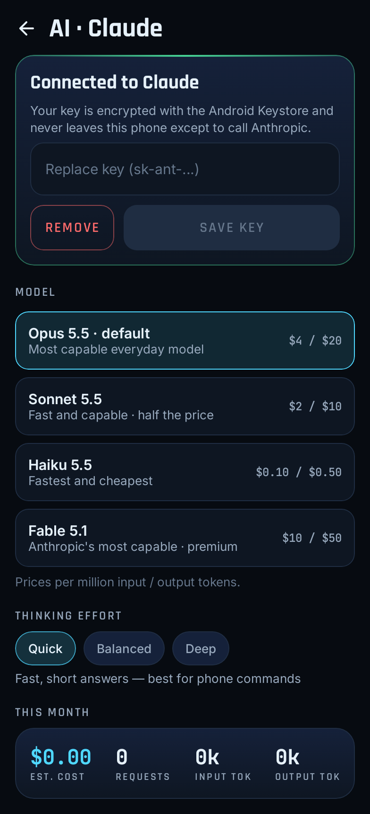

# Sarathi · सारथी

Your charioteer: a personal assistant for Android that keeps your day, habits,
money, focus and the Bhagavad Gita in one calm, HUD-style app. Instant
commands run on the phone with no network; Claude handles everything else
and can act for you through 29 tools.

Sarathi 3.0 is a ground-up rebuild of Sarathi 2.1 in Kotlin and Jetpack
Compose. See [CHANGELOG.md](CHANGELOG.md) for what's new and
[PLAN.md](PLAN.md) for how 2.1 was analysed.

| HUD (Arc) | HUD (Day) | Sarathi chat | Plan |
|---|---|---|---|
|  |  |  |  |
| **Money** | **Gita** | **Focus** | **AI settings** |
|  |  |  |  |

## Features

- **HUD home**
  - A big clock and "next up", plus a weather chip.
  - Four rings: tasks, habits, focus minutes and budget pace.
  - A **Today timeline** that merges overdue tasks, timed tasks, calendar
    events, the running focus session and habit chips.
  - The shloka of the day with *Reflect* and *Listen*.
- **Sarathi chat**
  - Streaming replies with live tool status and result cards, plus voice
    input.
  - Hands-free conversation mode: say "thank you" to end it.
  - Conversation history.
- **Instant commands, offline.** These run on the phone with no network:
  - "spent 200 on lunch"
  - "remind me to call amma at 6pm tomorrow"
  - "timer 10 min"
  - "wake me up at 6:30"
  - "15% of 2000"
  - "focus 50 on report"
  - "done meditation"
  - "open gita"
- **Plan**
  - Tasks with natural-language dates, reminders, priorities and repeats.
  - Swipe to delete, with undo.
  - Habits with a 7-day check row, streaks, streak freezes and a 12-week
    heatmap.
- **Money**
  - A month burn bar with a pace marker, and insights.
  - Per-category budget envelopes.
  - Transactions grouped by day, and CSV export.
  - Logging expenses from shared UPI text.
- **Gita.** Chapters, search, bookmarks, reading progress, Sanskrit with IAST
  transliteration, listen, and journal prompts.
- **Notes and Journal.** Notes in a staggered grid with pinning; daily
  reflection with mood and a writing streak.
- **Focus.** A pomodoro ring with breaks, an ongoing countdown notification,
  and an exact end chime.
- **Weekly review.** Tasks, habits, focus, spending and journal for the week,
  shareable.
- **Around the phone**
  - Reminder notifications with Done and Snooze, and a morning briefing.
  - Home-screen widgets (Shloka, Today) and Quick Settings tiles (Ask
    Sarathi, Quick expense).
  - "Ask Sarathi" from any text selection or share sheet.
  - The assist gesture opens voice.
- **Design**
  - Five themes: Arc, Saffron, Ember, Nebula and the light Day theme, plus
    Auto by time of day.
  - Customisable bottom bar around the Sarathi orb, and a command palette.
  - Haptics and sounds that follow your settings.
  - Accessibility: 48 dp touch targets, content descriptions, system font
    scaling.

## Claude

- **Models.** Opus 5.5 by default; Sonnet 5.5, Haiku 5.5 and Fable 5.1 can
  be chosen in Settings → AI.
- **Request handling.**
  - Uses API version `2026-10-21`.
  - Auto prompt caching.
  - Effort set explicitly (Quick, Balanced or Deep).
  - Server-side refusal fallbacks where supported.
  - Streamed tool input is strictly validated before any tool runs.
- **Append-only conversations.** The system prompt and tool list are frozen
  per conversation, and thinking blocks are replayed verbatim. This keeps
  the cache and thinking valid.
- **Cost meter.** Estimated monthly spend, with an optional cap that switches
  to Haiku 5.5.
- **Your key.** The API key is stored with the Android Keystore
  (AES-256-GCM) and is never included in backups.

## Build

Requirements: JDK 21 and the Android SDK (platform 36). Then:

```sh
./gradlew :app:testDebugUnitTest      # 50 tests: domain, AI client, screenshots
./gradlew :app:assembleRelease        # R8-shrunk APK in app/build/outputs/apk/release/
./gradlew :app:recordRoborazziDebug   # re-render docs/screenshots
```

Release signing reads `keystore.properties` from the project root (it is
git-ignored):

```properties
storeFile=/path/to/sarathi-release.jks
storePassword=…
keyAlias=sarathi
keyPassword=…
```

Without a keystore, release builds fall back to the debug key.

**CI.** `.github/workflows/android.yml` runs the tests and builds the APK on
every push. Tagging `v*` publishes a GitHub Release with the APK attached.
To sign CI builds, add these repository secrets: `SARATHI_KEYSTORE_BASE64`,
`SARATHI_KEYSTORE_PASSWORD`, `SARATHI_KEY_ALIAS` and `SARATHI_KEY_PASSWORD`.

## Architecture

```
app/src/main/java/com/k/sarathi/
  core/     Store: one JSON file, atomic writes, .bak recovery
  data/     Models, Repo (all data operations), bundled Content
  domain/   Pure logic: TimeParse, Commands, Calc, Money, Streaks, Recurrence, Review, pricing
  ai/       Claude client (SSE), ToolSpecs and ToolExecutor, Brain (offline first, then Claude)
  device/   Alarms and notifications, focus, voice, Keystore vault, widgets, tiles, share
  ui/       Theme, components, shell and navigation, screens
```

The UI talks only to `Repo`, `Brain` and small interfaces (`Device`,
`Voice`, `Platform`, `KeyVault`). The tests therefore swap in fakes, and
real screens render on the JVM with Robolectric and Roborazzi.

## Privacy

- Everything stays on the phone, in one file you can export.
- Network calls go only to Anthropic (when you add a key) and Open-Meteo (for
  weather, which needs no account).
- Cloud backup is disabled.

## Credits

- Quotes are original to Sarathi.
- Shloka Sanskrit text is public domain; the English meanings are original
  paraphrases.
- Fonts: Orbitron, Rajdhani, Inter and JetBrains Mono (SIL OFL).
- Icons: Material Symbols (Apache 2.0).
- Weather: Open-Meteo.
